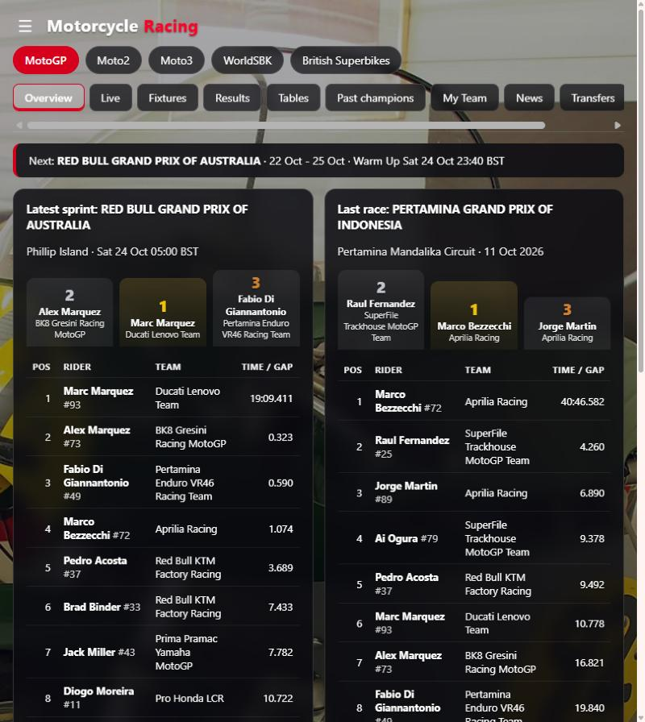
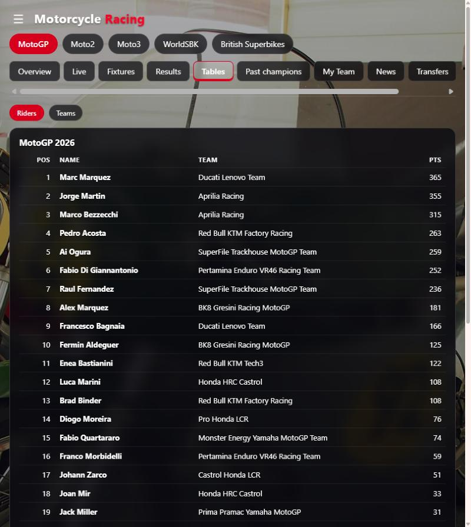

# Motorcycle Racing for Home Assistant

[](https://hacs.xyz)
[](https://github.com/Manzo76/ha-motorcycle-racing-2/actions/workflows/validate.yml)

Track a motorcycle racing championship in Home Assistant: next round, the full
weekend schedule, last race classification, championship standings and a
calendar you can drop straight onto a dashboard. A custom Lovelace card ships
with the integration and registers itself, so there is nothing extra to install.

Pick your series when you add it: MotoGP, Moto2, Moto3, MotoE, WorldSBK or
British Superbikes. Other motorcycle series from TheSportsDB can be added too,
but data quality varies. Add the integration once per series you want to follow.

## Screenshots

A sidebar dashboard with a tab for every class (live data, sample from the 2026 Australian GP weekend):

<p>
  
  
</p>

---

## Install

### Via HACS

1. HACS → three-dot menu → **Custom repositories**.
2. Repository `https://github.com/Manzo76/ha-motorcycle-racing-2`, category **Integration**.
3. Find **Motorcycle Racing** in HACS and download it.
4. Restart Home Assistant.
5. **Settings → Devices & services → Add integration → Motorcycle Racing**.

### Manually

Copy `custom_components/motorcycle_racing` into your `config/custom_components`
folder and restart.

---

## Where the data comes from

| Series | Source | Key needed |
| --- | --- | --- |
| MotoGP, Moto2, Moto3, MotoE | The public results feed behind motogp.com | No |
| WorldSBK, British Superbikes, others | [TheSportsDB](https://www.thesportsdb.com/) | No — a shared free key is used by default |

The Grand Prix classes get the richer picture: every session of the weekend with
its own start time, track and air temperature, and a full classification with
gaps and points. TheSportsDB series get schedule, artwork and results, with the
classification parsed from the published result text, so it is occasionally
thinner. Adding your own TheSportsDB key in the options lifts the shared rate
limit.

Neither source is an official partner feed. Both are used read-only, and this
project is not affiliated with Dorna Sports or any championship.

---

## Entities

One device per series, named after the series. Entity ids below assume MotoGP.

| Entity | State | Useful attributes |
| --- | --- | --- |
| `sensor.motogp_next_race` | Name of the next round | `circuit`, `country`, `round`, `sessions`, `days_until`, `race_start`, `poster` |
| `sensor.motogp_next_session` | Name of the next session | `kind`, `start`, `minutes_until`, `weather`, `event` |
| `sensor.motogp_next_session_time` | Timestamp of that session | — (device class `timestamp`, so it works in time triggers) |
| `sensor.motogp_last_race` | Winner of the last race | `podium`, `classification`, `event`, `winning_time` |
| `sensor.motogp_rider_standings` | Championship leader | `standings`, `leader_points`, `lead_margin`, `runner_up` |
| `sensor.motogp_team_standings` | Leading team | `standings` |
| `sensor.motogp_season_round` | Rounds completed | `total_rounds`, `rounds_remaining`, `progress_percent`, `calendar` |
| `sensor.motogp_favourite_rider` | Your rider's championship position | `points`, `points_behind_leader`, `last_race_position` |
| `binary_sensor.motogp_race_weekend` | On from four days out until the flag | `event`, `circuit` |
| `binary_sensor.motogp_session_live` | On while a session is running | `session`, `kind`, `weather` |
| `binary_sensor.motogp_race_day` | On during the day of the main race | — |
| `calendar.motogp` | Next session | Every session of the season |

The favourite rider sensor only appears once you set a name in the options.

Polling backs off to every 30 minutes out of season and speeds up to every 2
minutes from four days before a round. Both are configurable.

---

## The dashboard (sidebar panel)

Installing the integration adds a **Motorcycle Racing** entry to the Home Assistant sidebar. Pick a class with the chips at the top (your choice is remembered in the browser), then use the tabs:

- **Overview** - last race podium, championship top 10, next round (or champion and next season once the season is over)
- **Live** - timing for the session in progress, or the latest sessions of the current weekend; refreshes every 30 seconds
- **Fixtures** - the season calendar; click a round to see its results
- **Results** - choose any finished race weekend and session
- **Tables** - rider and team championship tables
- **Past champions** - the class history, newest season first
- **Records** - all-time most wins, poles, podiums, titles, fastest laps and MotoGP sprint wins (read live from Wikipedia), plus the premier-class lap record at every circuit (a curated, dated list)

Times follow your Home Assistant profile time zone. Background photo: CC0 / public domain, from [Wikimedia Commons](https://commons.wikimedia.org/wiki/File:Motor-Sport-Museum_am_Hockenheimring,_unidentified_motorcycle,_pic-005.JPG).

Four more tabs:

- **My Team** - pick a team to see its riders (with this season's points), a Wikipedia summary and photo, and facts such as base, principal and sponsors when Wikipedia lists them. Your pick is remembered per class.
- **News** - the latest headlines for the class from [Crash.net](https://www.crash.net/) RSS feeds, with links out to the full stories.
- **Transfers** - next season's movers (team changes, new riders, riders not yet on the list), worked out by comparing Wikipedia's current and next-season entry lists for MotoGP, Moto2 and Moto3, plus rider-market headlines for every class. Next-season lists are provisional.
- **TV guide** - pick your country (defaults to your Home Assistant country) to see which channels carry each class, with upcoming session times in your time zone. The channel list is curated from the championships' own "where to watch" pages and dated, because broadcast rights change often and there is no public feed for them.

Every live source degrades on its own: if one is unreachable that tab says so and the rest keep working.

## The card

The card is served by the integration at `/motorcycle_racing/motorcycle-racing-card.js`
and added as a frontend resource automatically. If you would rather manage the
resource yourself, turn off **Serve the bundled dashboard card** in the options.

```yaml
type: custom:motorcycle-racing-card
series: motogp
```

That is the whole minimum config — the card finds the rest of the entities
through the device. Everything else is optional:

| Option | Default | What it does |
| --- | --- | --- |
| `series` | — | Series key: `motogp`, `moto2`, `moto3`, `motoe`, `worldsbk`, `bsb` |
| `entity` | — | Point at a "Next race" sensor instead, for custom leagues |
| `title` | Series name | Header text |
| `accent` | Series colour | Any CSS colour; drives the lamps, kerbs and bars |
| `standings_rows` | 5 | Championship rows to show |
| `results_rows` | 5 | Classification rows to show |
| `show_gantry` | true | The five-lamp start light countdown |
| `show_sessions` | true | Weekend schedule strip |
| `show_results` | true | Last race classification |
| `show_standings` | true | Championship table |
| `show_podium` | true | Gold/silver/bronze podium for the last race |
| `show_icon` | true | The brand icon in the card header |
| `show_history` | true | Past champions table, newest season first |
| `history_rows` | 5 | How many past seasons to list |
| `time_zone` | `local` | `local` (your device / HA profile), `server`, any IANA zone such as `Europe/London`, or `GMT` |
| `date_locale` | HA language | Locale used to format dates, e.g. `en-GB` |

**Local time.** Every time on every card is shown in your own time zone,
following your Home Assistant profile (device zone, or server zone if you have
chosen that), including summer/winter clock changes. Set `time_zone` to pin a
card to a fixed zone.

**Live sessions.** While a session is running the card shows a LIVE banner and
the start lights go green.

**Past champions.** Each class lists its previous riders' champions with their
team, newest season first (the season that has just finished goes straight on
top). MotoGP, Moto2, Moto3 and MotoE history is read once from the official
results feed, saved to disk, and only topped up when a new season starts.
WorldSBK and British Superbikes have no free results feed, so their history
ships with the integration (`data/champions.json`, from Wikipedia) and each new
champion is added automatically from the live standings when the season ends.
The full list is on the standings sensor as `champions_history`.

**Season complete.** When a series has run its final round, "Next race" reads
*Season complete* instead of counting down to next year's opener. The card shows
the champion rider and team, the final standings and the date next season
starts. The sensors expose `season_over`, `champion`, `champion_team` and
`next_season_start` for automations.

The countdown is a start-light gantry: the lamps fill one per hour over the last
five hours before the session, and go out when it starts. Times, gaps and points
are set in tabular monospace so the columns do not jitter as the numbers change,
and the divider stripes are lifted straight off a circuit kerb. It respects
`prefers-reduced-motion` and collapses to a single column on a phone.

`dashboards/racing-view.yaml` has a full example view with a calendar, a
conditional race-weekend panel, and two automations — a fifteen-minute warning
before lights out, and a result notification when the flag drops.

---

## Troubleshooting

**"Could not reach the results service" when adding a series.** Both upstreams
sit behind a CDN that occasionally rate-limits. Wait a minute and try again.

**Standings are empty on a TheSportsDB series.** Not every league has a
maintained table there. Schedule and results still work; the card hides the
panel rather than showing an empty box.

**Card says "No series connected".** Either the `series:` key does not match a
configured entry, or the browser cached the old resource. Hard-refresh, and
check Developer Tools → States for `sensor.<series>_next_race`.

Turn on debug logging to see exactly what the providers fetched:

```yaml
logger:
  logs:
    custom_components.motorcycle_racing: debug
```

Diagnostics are available from the device page and redact your API key.

---

## Contributing

Parser changes should come with a case in `tests/test_parsers.py`, which runs
offline with no Home Assistant install:

```bash
python3 tests/test_parsers.py
```

Adding a series means one entry in `SERIES_CATALOGUE` in `const.py`. If it is
already in TheSportsDB, users can pick it today under **Other series** without
any code change.

## Licence

Copyright (c) 2026 Manzo76. All rights reserved. Made by Manzo.

You may install and use this integration, unmodified, for personal,
non-commercial purposes. Copying, modifying or redistributing the code needs
the author's written permission. See [LICENSE](LICENSE).
